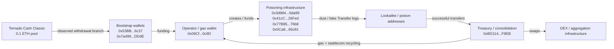
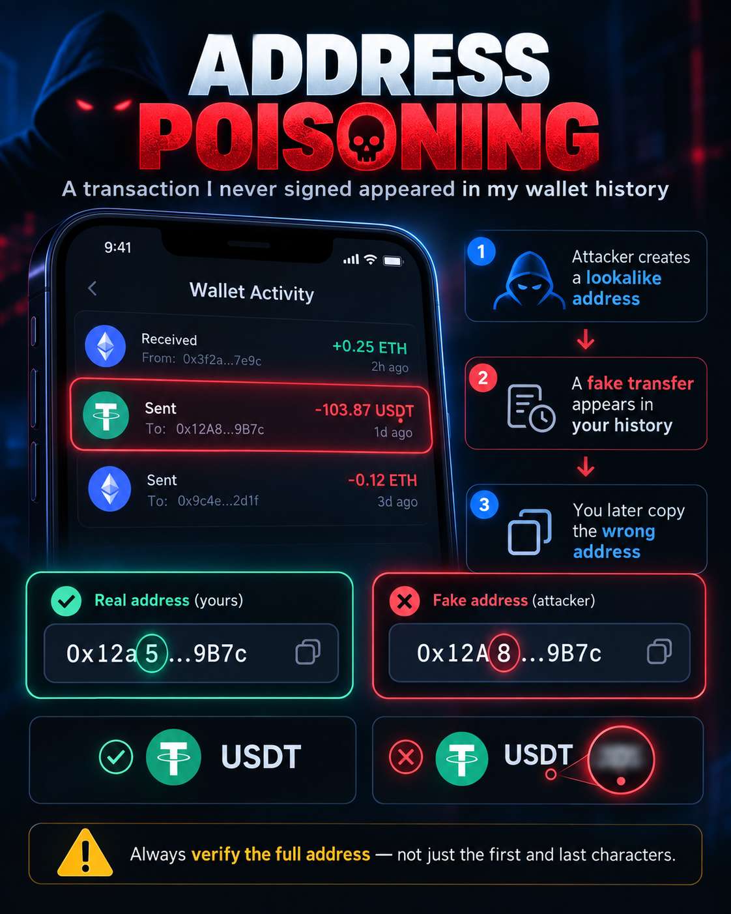

# Ethereum Address Poisoning — On-Chain Forensics of a Live Campaign

> A wallet UI showed an outgoing token transfer that the researcher never signed. Tracing the event led to an active Ethereum address-poisoning cluster, multiple successful transfers consistent with poisoning, a consolidation wallet, EIP-7702 infrastructure, and an observable funding branch involving Tornado Cash.

**Research status:** 26 September 2026  
**Chain:** Ethereum mainnet  
**Scope:** Public on-chain evidence only

## Why this repository exists

The investigation began with a wallet-history entry that looked like an outgoing transfer even though the researcher had not signed a transaction, paid gas, or lost funds.

The underlying mechanism was a malicious ERC-20-style event: a token contract can emit a `Transfer(from, to, amount)` log containing arbitrary addresses. Some wallet interfaces render these logs as transaction-history entries, which can make a fabricated transfer appear to have been sent by the wallet owner.

The original researcher's wallet, the lookalike address targeting it, and the triggering transaction hash are intentionally omitted from this repository. Publishing any of those would make the researcher's wallet trivially recoverable from public chain data.

## Key findings

- The initial wallet-history anomaly was **not a transaction signed by the researcher**.
- A recurring operator/gas wallet was identified: `0x09CfEe647fA339133380191C8DB6b44F24500c9D`.
- The operator created or funded multiple poisoning-related contracts and EIP-7702 accounts.
- A consolidation/treasury wallet was identified: `0xBD114DD6A8a8260fCf9632e537E69b9C0b83F9EB`.
- Four independently verified transfers were found that are strongly consistent with successful address poisoning and route into the same consolidation cluster.
- Minimum observed value across those four cases: **4.9849703145 ETH + 4,409.486930 USDT + 1,390 USDC**.
- Using the historical ETH price attached to the relevant transaction, this is approximately **$15.8k minimum observed loss** across the four cases. This is a lower bound, not a campaign total.
- An early observable funding branch into the operational cluster includes repeated withdrawals from the Tornado Cash Classic 0.1 ETH pool. This does **not** identify the deposit-side sender.
- As of 26 September 2026, no verified cash-out to a clearly tagged centralized-exchange deposit/hot wallet had been established in this investigation.

## Observed campaign flow



Arrows represent documented on-chain relationships. They do **not** identify a real-world person.

## Four observed successful cases

| Case | Source address | Poison address | Asset sent | Amount | Downstream consolidation |
|---|---|---|---:|---:|---|
| 1 | `0x680D559852643aC72383C232589e2799080e2c4F` | `0x284336EF3282B012bd1518Fe3D38042DFe87116a` | ETH | 4.9849703145 | `0xBD114...F9EB` |
| 2 | `0xd6fE5b68bf7d53D9b1C1Dfb1482DdBb81236bD3f` | `0xD2b665c4Ea3239224Fd5389e6baB6031829005C3` | USDT | 2,959.486930 | swapped to ETH, then `0xBD114...F9EB` |
| 3 | `0x1a10e8A7BFBb5925Bae9ad825B6A28e6FBebd820` | `0x51D3a8FA041aCfBFc5f425ee7265A9D83e33e390` | USDC | 1,390 | swapped to ETH, then `0xBD114...F9EB` |
| 4 | `0x6730418f0D76824Cd4BE0B7CDDD8E3722334bd6d` | `0x3428AB1cDb2a578B0685957AED9C29fd17AEB170` | USDT | 1,450 | swapped to ETH, then `0xBD114...F9EB` |

“Source address” is deliberately neutral wording. The evidence is strongly consistent with successful poisoning, but this repository does not claim knowledge of the real-world identity or intent of any wallet owner.

## Why a fake transfer can appear in wallet history

A malicious token contract can emit a log such as:

```text
Transfer(
    from   = RESEARCHER_WALLET,
    to     = LOOKALIKE_ADDRESS,
    amount = 103.87
)
```

The contract emitted the log; the researcher did not sign it. A wallet UI that relies heavily on token `Transfer` events may render the record as an outgoing transfer.

Useful checks are therefore:

- Who signed the outer transaction?
- Did the wallet nonce increase?
- Did the wallet pay gas?
- Is the token contract the genuine asset contract?
- Did the wallet's actual balance change?

For Ethereum mainnet, the genuine contracts used in this investigation are:

- **USDT:** `0xdAC17F958D2ee523a2206206994597C13D831ec7`
- **USDC:** `0xA0b86991c6218b36c1d19D4a2e9Eb0cE3606eB48`

A familiar token name or symbol is not sufficient proof that a token is genuine.

## How lookalike addresses are generated

Attackers do not need to reproduce the entire victim-recipient address. They generate many keypairs until an address matches the characters a wallet UI is likely to display.

If an attacker wants to match `n` hexadecimal characters, the search space is approximately:

```text
16^n
```

Examples:

| Visible characters matched | Search space |
|---:|---:|
| 7 | 268,435,456 |
| 8 | 4,294,967,296 |
| 9 | 68,719,476,736 |

This is computationally expensive but highly parallelizable. Matching a short prefix and suffix is fundamentally different from reproducing an entire Ethereum address.

## Reproduce the transaction checks

The repository contains a small verifier that queries Blockscout's public Ethereum API for the evidence transactions:

```bash
python scripts/verify_transactions.py
```

It prints the transaction sender, recipient, status, native value and ERC-20 transfers returned by the explorer API.

The script is intentionally read-only.

## Repository structure

```text
.
├── README.md
├── DISCLAIMER.md
├── LICENSE
├── assets/
│   └── address-poisoning-cover.png
├── data/
│   ├── addresses.csv
│   ├── cases.csv
│   └── transactions.csv
├── docs/
│   ├── evidence.md
│   ├── methodology.md
│   ├── privacy.md
│   └── timeline.md
└── scripts/
    ├── vanity_search_cost.py
    └── verify_transactions.py
```

## Research boundaries

This repository makes **on-chain attribution statements**, not real-world identity claims. A router, bridge, relayer, exchange wallet, or mixer interaction must not be treated as proof that the service itself participated in the attack.

See [DISCLAIMER.md](DISCLAIMER.md) and [docs/methodology.md](docs/methodology.md).

## Visual summary


